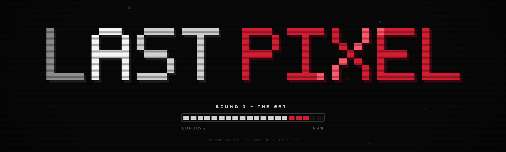
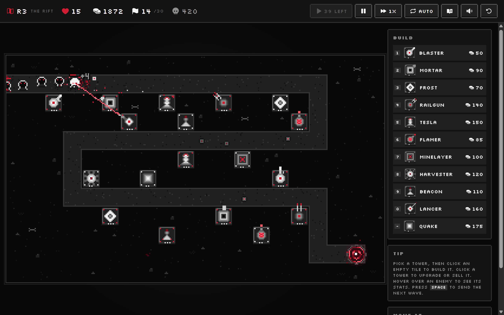
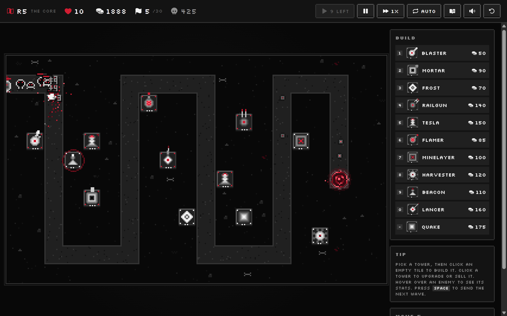

<div align="center">



### A monochrome pixel-art tower defense game for the browser.

The world has gone grey. One red pixel is left. Hold the line.

[](https://lastpixel.alex.codes)


[](LICENSE)

</div>

<br />

<p align="center">
  
</p>

## The story

Everything was drawn in colour once. Then the **Static** came, a grey tide that erases whatever it touches. One pixel of red survived inside the Portal, and while it burns, the world can still be redrawn.

You are its Keeper. Over five rounds, the Static pushes deeper with new tricks. It sends Menders that stitch the horde back together, Glitches that skip through your lines and, at the very end, **the Eraser**.

## Features

- **5 handcrafted rounds** with a story campaign, from The Gate down to The Core, each harder than the last
- **11 towers**, each with 3 upgrade levels and its own job: chain lightning, armor-piercing fire, knockback, mines, buff auras and economy
- **10 enemy types**, with armor, splitting, slow immunity, healing, blinking and two bosses
- **Targeting modes** (first, last, strongest, closest) per tower
- **Endless mode** once you clear wave 30
- **Autosave** between waves, so you can close the tab and pick up where you left off
- **Speed controls and auto-wave** for when you know your build works
- **Zero image or audio files.** Every sprite is drawn in code on a strict 12-colour palette, and every sound effect and track is synthesised live with the Web Audio API
- **Plays on desktop and mobile**, with full keyboard shortcuts on desktop
- **Built-in trailer** that renders itself from the game engine and can export to video

<p align="center">
  
</p>

## Towers

| Key | Tower | Role | Unlocks |
| :-: | --- | --- | :-: |
| `1` | **Blaster** | Rapid single-target shots. Weak against armor. | Round 1 |
| `2` | **Mortar** | Lobs shells that damage everything in a blast radius. | Round 1 |
| `3` | **Frost** | Pulses cold that slows every foe in range. | Round 1 |
| `4` | **Railgun** | Long-range beam that pierces every foe in a line. | Round 1 |
| `5` | **Tesla** | Lightning that arcs between nearby foes. | Round 1 |
| `6` | **Flamer** | Short cone of fire. Burning ignores armor. | Round 2 |
| `7` | **Minelayer** | Seeds the nearby road with mines that blow on contact. | Round 2 |
| `8` | **Harvester** | No attack. Pays gold each wave and boosts kill gold nearby. | Round 2 |
| `9` | **Beacon** | No attack. Boosts damage and fire rate of towers around it. | Round 3 |
| `0` | **Lancer** | Steady laser that heats up the longer it holds a target. | Round 3 |
| `-` | **Quake** | Slams the ground, knocking foes back and stunning them. | Round 3 |

## The horde

| Enemy | Trait |
| --- | --- |
| **Crawler** | The bulk of the horde. Slow and steady. |
| **Runner** | Fast and fragile. Dies to almost anything. |
| **Brute** | A slow wall of flesh that soaks up damage. |
| **Husk** | A plated shell that shrugs off small hits. |
| **Splitter** | Bursts into three Runners when killed. |
| **Wisp** | A flickering spirit that cold cannot touch. |
| **Mender** | Heals the horde around it. Kill it first. |
| **Glitch** | Skips frames, blinking forward through your lines. |
| **Colossus** | Boss. Arrives every 10 waves. |
| **The Eraser** | Final boss. Every tower it passes goes silent. |

## Controls

| Input | Action |
| --- | --- |
| `1` to `0`, `-` | Pick a tower to build |
| Click a tile | Build the picked tower (hold `Shift` to keep building) |
| Click a tower | Select it to upgrade, sell or change targeting |
| `Space` | Send the next wave |
| `U` | Upgrade the selected tower |
| `S` / `Delete` | Sell the selected tower |
| `T` | Cycle targeting mode |
| `F` | Cycle game speed (1x, 2x, 3x) |
| `P` | Pause |
| `Esc` | Cancel / deselect |

## Run it locally

You need [Node.js](https://nodejs.org) 18 or newer.

```bash
git clone https://github.com/byalex33/last-pixel.git
cd last-pixel
npm install
npm run dev
```

Then open http://localhost:5173.

| Script | What it does |
| --- | --- |
| `npm run dev` | Start the dev server with hot reload |
| `npm run build` | Type-check and build the game into `dist/` |
| `npm run preview` | Serve the production build locally |
| `npm run typecheck` | Run the TypeScript compiler without emitting |
| `npm run build:trailer` | Build the standalone trailer page into `dist-trailer/` |

The trailer is also available in dev at http://localhost:5173/trailer.html.

## How it's built

There is no game framework. The whole thing is React for the UI shell and a hand-rolled engine drawing to a single `<canvas>`.

```
src/
  game/
    engine.ts      Fixed-step simulation, targeting, projectiles, waves, input
    data.ts        Tower and enemy stats, waves, unlocks
    maps.ts        The five maps, defined as tile waypoints
    sprites.ts     Every sprite, drawn procedurally onto offscreen canvases
    audio.ts       Synthesised sound effects and music (Web Audio API)
    lore.ts        The story, one chapter per round
    storage.ts     Autosave, best waves and settings in localStorage
  components/      React UI: HUD, build panel, inspector, story, loader
  trailer/         Self-directing trailer built on the real engine, with video export
```

The game runs on a 320 x 192 logical canvas (20 x 12 tiles of 16px), updated at a fixed 60 steps per second and scaled up with crisp pixels. The palette is eight greys and four reds, nothing else.

## Contributing

Issues and pull requests are welcome. If you want to add a tower, enemy or map, most of it lives in `src/game/data.ts` and `src/game/maps.ts`. Please run `npm run typecheck` before opening a PR.

## License

[MIT](LICENSE). Do what you like with it.
